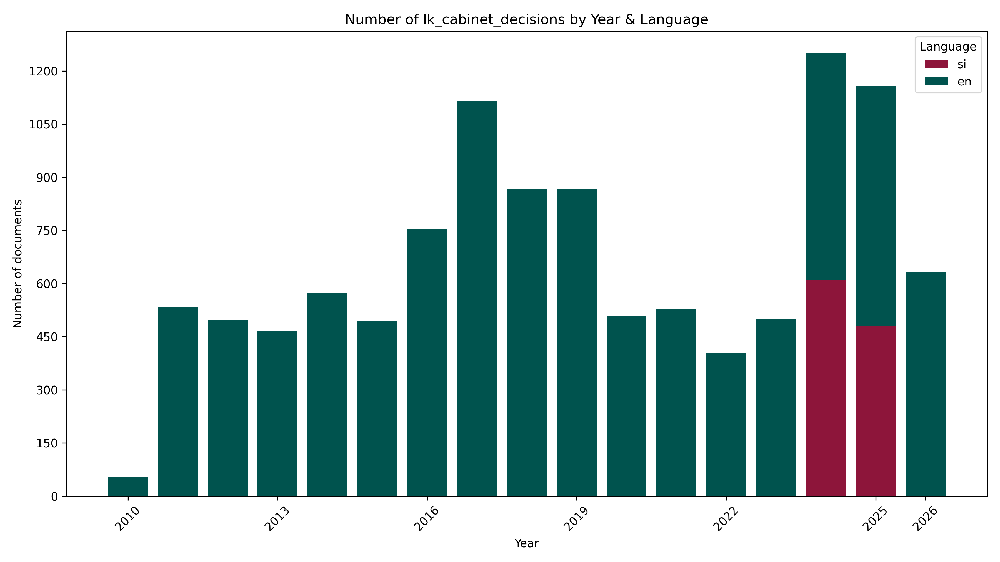

# 🏛️#SriLanka 🇱🇰 Cabinet Decisions `Dataset`


[https://github.com/nuuuwan/lk_cabinet_decisions/tree/data/data/lk_cabinet_decisions](https://github.com/nuuuwan/lk_cabinet_decisions/tree/data/data/lk_cabinet_decisions)

A Sri Lanka Cabinet Decision is an official policy or action agreed by the Cabinet of Ministers, shaping governance, law, and national development in the country.

- [**11,202** documents](https://github.com/nuuuwan/lk_cabinet_decisions/tree/data/data/lk_cabinet_decisions) (**143.9 MB**), from **2010-09-27** to **2026-11-02**, scraped from [https://www.cabinetoffice.gov.lk](https://www.cabinetoffice.gov.lk)

- In **JSON**, **TXT** (93%) & **🤗 Hugging Face** (93%)

- In **සිංහල** & **English**

- 🎓 Cite as **[arXiv:2510.04124](https://arxiv.org/abs/2510.04124) [cs.CL]**

## 📝 Example Metadata

```json
{
    "doc_type": "lk_cabinet_decisions",
    "doc_id": "2026-11-02-014-en",
    "num": "14",
    "date_str": "2026-11-02",
    "description": "Rehabilitation of road Infrastructure damaged due to the cyclone Ditwah",
    "url_metadata": "https://www.cabinetoffice.gov.lk/cab/index.php?option=com_content&view=article&id=16&Itemid=49&lang=en&dID=14323",
    "lang": "en",
    "decision_details_title": "Press briefing of Cabinet Decision taken on 2026-11-02 (Subject to Confirmation at the next Meeting)",
    "decision_details_body": "- Bids have been invited, following the national competitive procurement method, for the selection of contractors to rehabilitate and improve several road sections damaged by the Cyclone 'Ditwah'. Based on the recommendations submitted by the High Level Procurement Committees following the evaluation of the bids so received, the Cabinet approved the proposals made by the Minister of Transport, Highways, and Urban Development to award the said contracts to the substantially responsive lowest bidders, as follows:"
}
```



## 🤗 Hugging Face Datasets


- [nuuuwan/lk-cabinet-decisions-docs](https://huggingface.co/datasets/nuuuwan/lk-cabinet-decisions-docs)
- [nuuuwan/lk-cabinet-decisions-chunks](https://huggingface.co/datasets/nuuuwan/lk-cabinet-decisions-chunks)

## 🆕 20 Latest documents

- 2026-11-02 | `14` | Rehabilitation of road Infrastructure damaged due to the cyclone Ditwah | [data](https://github.com/nuuuwan/lk_cabinet_decisions/tree/data/data/lk_cabinet_decisions/2020s/2026/2026-11-02-014-en)
- 2026-11-02 | `13` | Making provisions to give effect to the Sri Lanka's obligations under the Convention on Cluster Munitions | [data](https://github.com/nuuuwan/lk_cabinet_decisions/tree/data/data/lk_cabinet_decisions/2020s/2026/2026-11-02-013-en)
- 2026-11-02 | `12` | Augmentation of Kolonnawa Grid Substation for the Development of 100 MW/100 MWh Battery Energy Storage System | [data](https://github.com/nuuuwan/lk_cabinet_decisions/tree/data/data/lk_cabinet_decisions/2020s/2026/2026-11-02-012-en)
- 2026-11-02 | `11` | Implementation of the Sampur Kappalthurai Transmission Infrastructure Development Project | [data](https://github.com/nuuuwan/lk_cabinet_decisions/tree/data/data/lk_cabinet_decisions/2020s/2026/2026-11-02-011-en)
- 2026-11-02 | `10` | Resuming the Project for the Construction of the New Walapane Magistrate’s Court Complex | [data](https://github.com/nuuuwan/lk_cabinet_decisions/tree/data/data/lk_cabinet_decisions/2020s/2026/2026-11-02-010-en)
- 2026-11-02 | `9` | Procurement for the supply of 54,000 liposomal form of Amphotericin B 50mg Vials | [data](https://github.com/nuuuwan/lk_cabinet_decisions/tree/data/data/lk_cabinet_decisions/2020s/2026/2026-11-02-009-en)
- 2026-11-02 | `8` | Procurement for the supply of 1,100,000 Peritoneal dialysis solution bags | [data](https://github.com/nuuuwan/lk_cabinet_decisions/tree/data/data/lk_cabinet_decisions/2020s/2026/2026-11-02-008-en)
- 2026-11-02 | `7` | Land Development and Drainage System Improvement Project related to the Rathgama Town Development Project | [data](https://github.com/nuuuwan/lk_cabinet_decisions/tree/data/data/lk_cabinet_decisions/2020s/2026/2026-11-02-007-en)
- 2026-11-02 | `6` | Rehabilitation of road Infrastructure damaged due to the cyclone Ditwah | [data](https://github.com/nuuuwan/lk_cabinet_decisions/tree/data/data/lk_cabinet_decisions/2020s/2026/2026-11-02-006-en)
- 2026-11-02 | `5` | Widening and Improvement of the Road Section surrounding Vavuniya town of the Kandy-Jaffna Road (A9) | [data](https://github.com/nuuuwan/lk_cabinet_decisions/tree/data/data/lk_cabinet_decisions/2020s/2026/2026-11-02-005-en)
- 2026-11-02 | `4` | Development of the Hamilton Canal and the associated aquatic environment as a place of Tourist attraction | [data](https://github.com/nuuuwan/lk_cabinet_decisions/tree/data/data/lk_cabinet_decisions/2020s/2026/2026-11-02-004-en)
- 2026-11-02 | `3` | Construction of a State-of-the-Art Building for the Faculty of Allied Health Sciences of the University of Jaffna | [data](https://github.com/nuuuwan/lk_cabinet_decisions/tree/data/data/lk_cabinet_decisions/2020s/2026/2026-11-02-003-en)
- 2026-11-02 | `2` | Memorandum of Understanding on Cooperation in establishing a modern Public Service delivery mechanism between Azerbaijan and Sri Lanka | [data](https://github.com/nuuuwan/lk_cabinet_decisions/tree/data/data/lk_cabinet_decisions/2020s/2026/2026-11-02-002-en)
- 2026-11-02 | `1` | Implementation of the Project on Advancing Sustainable Trade between the European Union and Sri Lanka | [data](https://github.com/nuuuwan/lk_cabinet_decisions/tree/data/data/lk_cabinet_decisions/2020s/2026/2026-11-02-001-en)
- 2026-10-26 | `13` | Hosting the 14th Commonwealth Women's Affairs Ministers Meeting | [data](https://github.com/nuuuwan/lk_cabinet_decisions/tree/data/data/lk_cabinet_decisions/2020s/2026/2026-10-26-013-en)
- 2026-10-26 | `12` | Hosting the Inaugural BIMSTEC Health Ministers' Meeting and BIMSTEC Senior Officials’ Meeting on Health | [data](https://github.com/nuuuwan/lk_cabinet_decisions/tree/data/data/lk_cabinet_decisions/2020s/2026/2026-10-26-012-en)
- 2026-10-26 | `11` | Imposing Regulations for Registration of Intellectual Property Agents (IP Agents) under the Intellectual Property Act No.36 of 2003 | [data](https://github.com/nuuuwan/lk_cabinet_decisions/tree/data/data/lk_cabinet_decisions/2020s/2026/2026-10-26-011-en)
- 2026-10-26 | `10` | Submission of the Licensing of Produce Brokers (Tea) Regulations, to Parliament for approval | [data](https://github.com/nuuuwan/lk_cabinet_decisions/tree/data/data/lk_cabinet_decisions/2020s/2026/2026-10-26-010-en)
- 2026-10-26 | `9` | Rehabilitation and improvement of Norwood-Bogawanthalawa - Campion Road (B329) road - from Ch.10+500km to Ch.16+890km | [data](https://github.com/nuuuwan/lk_cabinet_decisions/tree/data/data/lk_cabinet_decisions/2020s/2026/2026-10-26-009-en)
- 2026-10-26 | `8` | Provision of Compensation and Relief to Prison Officers who tragically lost their lives and sustained injuries while on duty at the Negombo Prison | [data](https://github.com/nuuuwan/lk_cabinet_decisions/tree/data/data/lk_cabinet_decisions/2020s/2026/2026-10-26-008-en)

---

### [More Datasets about 🇱🇰 #SriLanka](https://github.com/nuuuwan/lk_datasets)


[](https://opensource.org/licenses/MIT)
