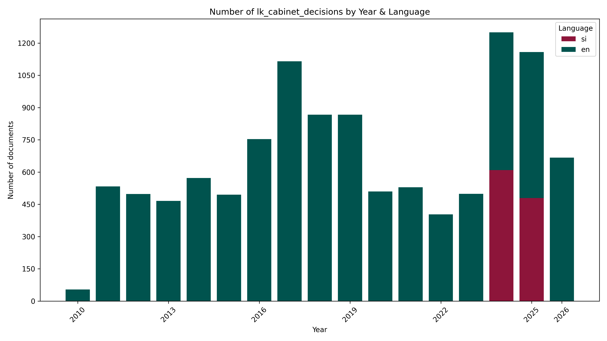

# 🏛️#SriLanka 🇱🇰 Cabinet Decisions `Dataset`


[https://github.com/nuuuwan/lk_cabinet_decisions/tree/data/data/lk_cabinet_decisions](https://github.com/nuuuwan/lk_cabinet_decisions/tree/data/data/lk_cabinet_decisions)

A Sri Lanka Cabinet Decision is an official policy or action agreed by the Cabinet of Ministers, shaping governance, law, and national development in the country.

- [**11,228** documents](https://github.com/nuuuwan/lk_cabinet_decisions/tree/data/data/lk_cabinet_decisions) (**144.1 MB**), from **2010-09-27** to **2026-11-16**, scraped from [https://www.cabinetoffice.gov.lk](https://www.cabinetoffice.gov.lk)

- In **JSON**, **TXT** (92%) & **🤗 Hugging Face** (92%)

- In **සිංහල** & **English**

- 🎓 Cite as **[arXiv:2510.04124](https://arxiv.org/abs/2510.04124) [cs.CL]**

## 📝 Example Metadata

```json
{
    "doc_type": "lk_cabinet_decisions",
    "doc_id": "2026-11-16-016-en",
    "num": "16",
    "date_str": "2026-11-16",
    "description": "Designating a Business as a Primary Business of Strategic Importance under the provisions of the Colombo Port City Economic Commission Act",
    "url_metadata": "https://www.cabinetoffice.gov.lk/cab/index.php?option=com_content&view=article&id=16&Itemid=49&lang=en&dID=14350",
    "lang": "en",
    "decision_details_title": "Press briefing of Cabinet Decision taken on 2026-11-16 (Subject to Confirmation at the next Meeting)",
    "decision_details_body": "- Approval was granted at the Cabinet meeting held on 2026-09-14 to designate Prime Melwa (Private) Limited as a Primary Business of Strategic Importance, under the provisions of the Colombo Port City Economic Commission Act,                  No.11 of 2021. Accordingly, an Order has been published through the Gazette Extraordinary Notification No.2507/47 dated 2026-09-23, designating Prime Melwa (Private) Limited as a Primary Business of Strategic Importance, enabling to grant the relevant tax exemptions and incentives. The proposal made by the Hon. President in his capacity as the Minister of Finance, Planning and Economic Development to present the said Order in Parliament for approval, was approved by the Cabinet."
}
```



## 🤗 Hugging Face Datasets


- [nuuuwan/lk-cabinet-decisions-docs](https://huggingface.co/datasets/nuuuwan/lk-cabinet-decisions-docs)
- [nuuuwan/lk-cabinet-decisions-chunks](https://huggingface.co/datasets/nuuuwan/lk-cabinet-decisions-chunks)

## 🆕 20 Latest documents

- 2026-11-16 | `16` | Designating a Business as a Primary Business of Strategic Importance under the provisions of the Colombo Port City Economic Commission Act | [data](https://github.com/nuuuwan/lk_cabinet_decisions/tree/data/data/lk_cabinet_decisions/2020s/2026/2026-11-16-016-en)
- 2026-11-16 | `15` | Implementation of the Climate-Resilient Sustainable Water Supply and Sanitation Project | [data](https://github.com/nuuuwan/lk_cabinet_decisions/tree/data/data/lk_cabinet_decisions/2020s/2026/2026-11-16-015-en)
- 2026-11-16 | `14` | Appointment to the Post of Director General of the Department of Government Factory | [data](https://github.com/nuuuwan/lk_cabinet_decisions/tree/data/data/lk_cabinet_decisions/2020s/2026/2026-11-16-014-en)
- 2026-11-16 | `13` | Intellectual Property Regulations No.01 of 2026 | [data](https://github.com/nuuuwan/lk_cabinet_decisions/tree/data/data/lk_cabinet_decisions/2020s/2026/2026-11-16-013-en)
- 2026-11-16 | `12` | Increasing the number of beneficiaries and the Capital Financial Grant of the Social Protection Project implemented under the World Bank Loan Programme | [data](https://github.com/nuuuwan/lk_cabinet_decisions/tree/data/data/lk_cabinet_decisions/2020s/2026/2026-11-16-012-en)
- 2026-11-16 | `11` | Awarding of Contracts for the Supply of Aviation Fuel to SriLankan Airlines Limited at Four (04) International Airports | [data](https://github.com/nuuuwan/lk_cabinet_decisions/tree/data/data/lk_cabinet_decisions/2020s/2026/2026-11-16-011-en)
- 2026-11-16 | `10` | Implementation of the Road Section from Kurunegala to Galewela, the First Phase of Section 4 of the Central Expressway Project, under 12 Contract Packages | [data](https://github.com/nuuuwan/lk_cabinet_decisions/tree/data/data/lk_cabinet_decisions/2020s/2026/2026-11-16-010-en)
- 2026-11-16 | `9` | Implementation of Stage I of the Oliyamulla Pumping Station Project | [data](https://github.com/nuuuwan/lk_cabinet_decisions/tree/data/data/lk_cabinet_decisions/2020s/2026/2026-11-16-009-en)
- 2026-11-16 | `8` | Widening of National Highways and Reconstruction of Road Infrastructure | [data](https://github.com/nuuuwan/lk_cabinet_decisions/tree/data/data/lk_cabinet_decisions/2020s/2026/2026-11-16-008-en)
- 2026-11-16 | `7` | Awarding contracts for the rehabilitation and improvement of roads under the Rural Road Programme | [data](https://github.com/nuuuwan/lk_cabinet_decisions/tree/data/data/lk_cabinet_decisions/2020s/2026/2026-11-16-007-en)
- 2026-11-16 | `6` | Execution of the Road Section from Kahathuduwa to Ingiriya, which is the Phase I of the Ruwanpura Expressway, under 11 contract packages | [data](https://github.com/nuuuwan/lk_cabinet_decisions/tree/data/data/lk_cabinet_decisions/2020s/2026/2026-11-16-006-en)
- 2026-11-16 | `5` | Strengthening meaningful youth participation in environmental processes and environmental education | [data](https://github.com/nuuuwan/lk_cabinet_decisions/tree/data/data/lk_cabinet_decisions/2020s/2026/2026-11-16-005-en)
- 2026-11-16 | `4` | Establishment of the National Nuclear Security Coordination Committee | [data](https://github.com/nuuuwan/lk_cabinet_decisions/tree/data/data/lk_cabinet_decisions/2020s/2026/2026-11-16-004-en)
- 2026-11-16 | `3` | Establishment of the Bangladesh-Sri Lanka Joint Consultative Commission for Comprehensive Cooperation between the Government of Bangladesh and the Government of Sri Lanka | [data](https://github.com/nuuuwan/lk_cabinet_decisions/tree/data/data/lk_cabinet_decisions/2020s/2026/2026-11-16-003-en)
- 2026-11-16 | `2` | Entering into Memoranda of Understanding/Agreement between Sri Lankan Universities and Foreign Universities for the purpose of Educational Cooperation | [data](https://github.com/nuuuwan/lk_cabinet_decisions/tree/data/data/lk_cabinet_decisions/2020s/2026/2026-11-16-002-en)
- 2026-11-16 | `1` | Establishment of the National Commission on Research and Development and its affiliated Office | [data](https://github.com/nuuuwan/lk_cabinet_decisions/tree/data/data/lk_cabinet_decisions/2020s/2026/2026-11-16-001-en)
- 2026-11-09 | `10` | Submission of the Veterinary Surgeons and Practitioners (Infamous Conduct) Regulations, No.1 of 2025, to Parliament for approval | [data](https://github.com/nuuuwan/lk_cabinet_decisions/tree/data/data/lk_cabinet_decisions/2020s/2026/2026-11-09-010-en)
- 2026-11-09 | `9` | Construction of a new railway bridge across the Mahaweli River between Sarasavi Uyana and Peradeniya of the Matale railway line | [data](https://github.com/nuuuwan/lk_cabinet_decisions/tree/data/data/lk_cabinet_decisions/2020s/2026/2026-11-09-009-en)
- 2026-11-09 | `8` | Widening of National Highways and reconstruction of road infrastructure facilities | [data](https://github.com/nuuuwan/lk_cabinet_decisions/tree/data/data/lk_cabinet_decisions/2020s/2026/2026-11-09-008-en)
- 2026-11-09 | `7` | Obtaining financial assistance for the Sector Development Programme (Sub‑programme 1) on Building a Strong and Inclusive Financial Ecosystem for Micro, Small and Medium-Sized Enterprises | [data](https://github.com/nuuuwan/lk_cabinet_decisions/tree/data/data/lk_cabinet_decisions/2020s/2026/2026-11-09-007-en)

---

### [More Datasets about 🇱🇰 #SriLanka](https://github.com/nuuuwan/lk_datasets)


[](https://opensource.org/licenses/MIT)
